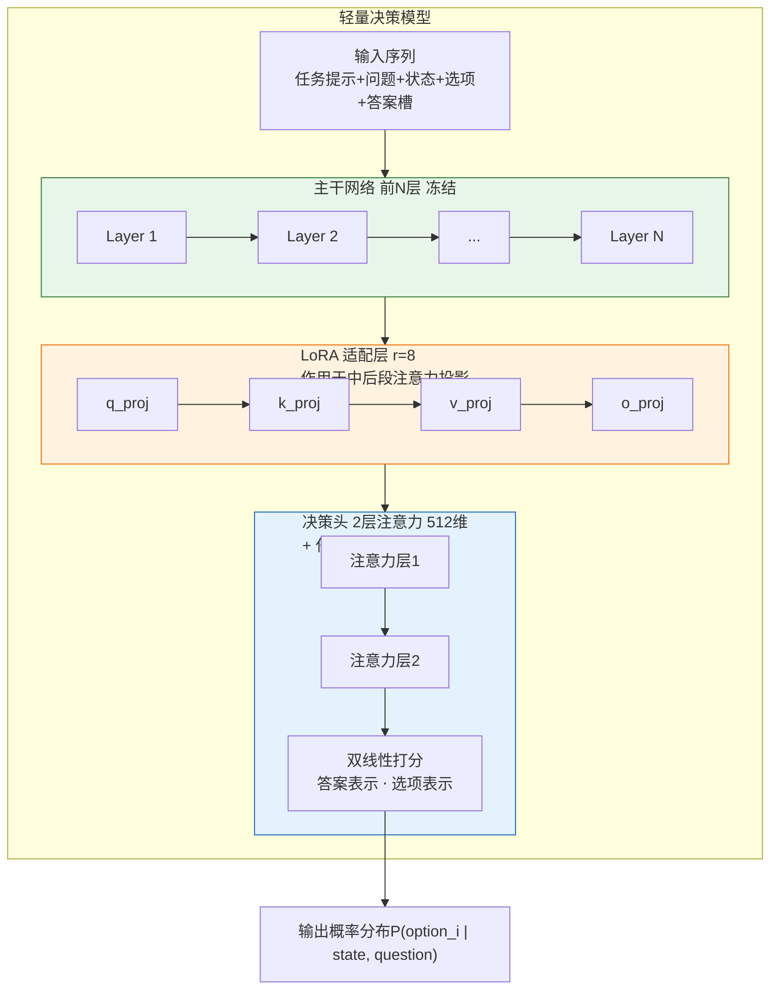
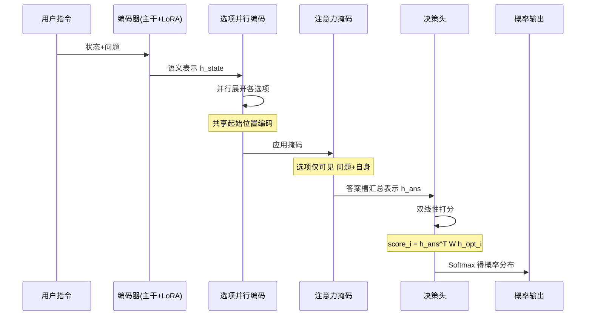
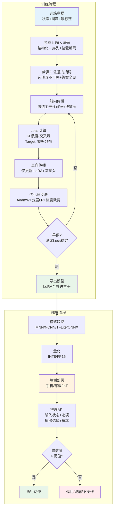
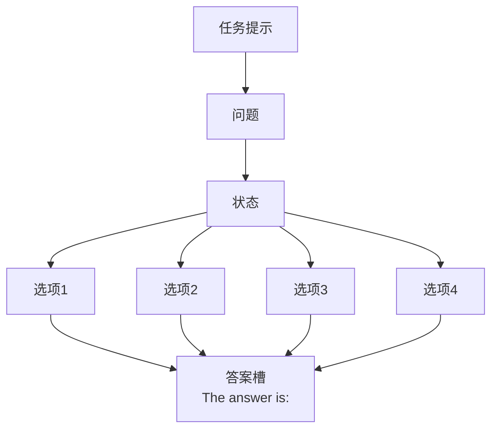

> 用「小基座 + LoRA 冻结微调 + 轻量决策头」的路线，把端侧决策建模为**状态理解 + 选项打分**的单次前向任务。训练数据融合用户指令与设备上下文，采用**概率软标签**保留决策不确定性，并显式建模「不操作」以保障安全。整套方法**与基座规模解耦**，可在 0.6B、1B、1.5B 等不同量级基座上复用，仅需训练百万级参数即可收敛，具备低延迟、可解释、易迭代、易迁移、隐私原生、离线可用的端侧部署特性。

<!--break-->

# 零、导语

> 本文档说明如何用「小基座 + 冻结主干 + 轻量适配」的路线，把端侧决策能力压缩进一个轻量模型，单次前向传播直接输出决策概率，不做文本生成。
>
> 文中以 **Qwen3-0.6B** 作为具体示例，但整套方法**与基座规模无关**，可平滑迁移到 1B、1.5B 乃至其他同量级开源基座。
>
> 本文是基于对[NeelContractor/jev-train](https://github.com/NeelContractor/jev-train)的学习理解生成的。感谢原作者及原作者声明的鸣谢对象。

# 一、总体思路

采用 **「小基座 + 冻结主干 + 轻量适配」** 的路线，把决策能力压缩进一个轻量模型，单次前向传播直接输出决策概率，**不做文本生成**。这样在手机端、穿戴设备、IoT 终端等算力受限、对延迟敏感的端侧设备上可以稳定部署。

核心设计：**决策 = 状态理解 + 选项打分**，而不是「让模型写一段话再解析」。

这套思路的关键在于**解耦**：

- **基座**负责「理解」——把用户指令（语音/文本）和设备上下文编码成语义表示；
- **适配层 + 决策头**负责「决策」——在语义表示上做选项打分。

因此基座可以按算力预算自由替换，而决策逻辑与训练流程保持不变。

# 二、模型结构特征

## 1. 通用结构



| 组件 | 设计 | 轻量化考量 |
|---|---|---|
| 主干 | 选取开源基座的**前 N 层**（按算力预算裁剪） | 直接削减参数量与计算量 |
| 适配层 | LoRA，仅作用于中后段若干层的注意力投影 | 可训练参数占比通常 < 1% |
| 决策头 | 轻量注意力头，带任务类型嵌入 | 参数量在百万级，替代整个生成式输出层 |

> N的选定原则见下文「层数 N 的选定」。

## 2. 基座选型（按算力预算）

| 基座规模 | 适用场景 | 说明 |
|---|---|---|
| 0.5B–0.6B | 手机端实时推理、资源极度受限 | 示例：Qwen3-0.6B 前 20 层，适合 NPU/ DSP 部署 |
| 1B–1.5B | 高性能手机、平板、座舱域控 | 语义理解更强，适合复杂多轮指令 |
| 更大规模 | 云端/离线批处理、边缘服务器 | 通常不用于端侧实时决策 |

> **示例（Qwen3-0.6B）**：主干取前 20 层（共 28 层），LoRA（r=8, alpha=16）作用于第 8–19 层的 `q/k/v/o_proj`，决策头为 2 层 512 维注意力头。总参数约 0.4B，其中可训练参数约 800 万（占比约 2%）。

## 3. 层数 N 的选定

**没有闭式理论公式**，N 是一个经验性的「效果—成本」折中，可依据以下原则并结合消融实验确定：

- **层功能分化**：Transformer 各层表征有分工——浅层偏词法/句法，中层偏语义/实体，深层偏任务特定与「下一个词预测」。
- **决策任务不需要生成层**：本方案是判别式打分，不依赖自回归生成，因此**最深的若干层（专为生成优化）往往可以裁掉**，损失最小。
- **收益递减**：准确率随 N 增长通常呈「先快后平」的曲线，存在拐点。
- **确定方法（消融扫描）**：在 {12, 16, 20, 24, 28} 等候选值上各训一次，选**达到最佳效果 X% 以内的最小 N**。
- **硬约束**：端侧延迟/显存/NPU 算力预算给出 N 的上界。

> 示例中取 20/28 层，即是在「保留足够语义理解」与「满足端侧延迟/功耗」之间的经验折中。

## 4. 关键机制：并行打分，而非逐字生成



传统做法是让模型生成一段文本（如「答案是：开启勿扰模式」）再解析，慢且易错。本方案改为**一次前向、并行打分**：

1. **选项并行编码**：所有选项共享同一个起始位置编码，各自独立展开，相当于「并排」放在序列里；
2. **选项互不可见**：注意力掩码让每个选项只能看到「问题 + 自己」，看不到其他选项；
3. **答案槽汇总**：末尾的「答案」token 能看到全部内容，形成一个汇总表示；
4. **双线性打分**：用答案表示与每个选项表示做内积，得到每个选项的分数。

由此带来两个好处：

- **顺序无关**：因为选项之间互不可见，把「开启勿扰」放在第一位还是最后一位，它的表示和得分都不变——决策不会因选项排列而改变；
- **一次前向**：所有选项同时打分，无需逐个生成，延迟低且稳定（手机端典型 < 50ms）。

# 三、训练数据的特征

## 1. 数据结构：状态 + 问题 + 答案

每条样本由三部分组成：

```json
{
  "state": {
    "input": "把静音模式开一下",
    "context": {
      "time": "22:30", "location": "家",
      "battery": 45, "network": "wifi",
      "active_app": "微信", "screen_state": "on",
      "ringer_mode": "normal", "dnd_schedule": "22:00-07:00"
    }
  },
  "question": {
    "kind": "choice",
    "options": ["开启勿扰", "调低音量", "关闭震动", "不操作"]
  },
  "target": [0.82, 0.10, 0.05, 0.03]
}
```

- `state.input`：用户指令（语音识别文本或文本输入）
- `state.context`：设备/环境上下文（时间、位置、电量、网络、前台应用、屏幕状态、系统设置等）
- `question.kind`：问题类型（`choice` / `noul` / `score`）
- `target`：概率分布，非硬标签

## 2. 数据特征（端侧场景特有）

- **多模态融合**：用户指令（语音/文本）+ 设备传感器上下文（时间、位置、电量、网络、应用状态、系统设置）联合建模，而非只看文本。
- **软标签监督**：`target` 是概率分布而非 one-hot。这保留了决策的**不确定性**——例如「安静一点」可能 70% 开启勿扰、20% 调低音量，符合真实使用中意图模糊的情况。
- **多任务统一**：同一套结构支持三类问题：
  - `choice`：多选一（如「开哪个功能」「切换到哪个模式」）
  - `noul`：是/否（如「是否紧急」「是否需要确认」）
  - `score`：有序打分（如「紧急程度」「用户满意度」）
- **口语化与噪声鲁棒**：数据包含大量口语、省略、ASR 错字（如「静音模式」→「静音模试」、「勿扰」→「物流」）、方言变体，迫使模型学习**语义而非字面匹配**。
- **负样本设计**：包含「今天天气怎样」「帮我查快递」等**与设备控制无关**的指令，标签指向「不操作」，避免模型对任何输入都强行执行系统动作。
- **隐私敏感感知**：上下文中包含位置、应用使用等敏感字段，训练时需脱敏/本地化处理，推理时严格在端侧完成，不上传原始数据。

## 3. 数据规模与切分

- 数据规模按任务复杂度与基座规模灵活调整：小基座 + 简单任务可用千级样本起步，复杂场景建议万级以上。
- 建议按 **训练 / 验证 / 测试** 划分，测试集保持独立，用于选择最佳 checkpoint。
- 数据量偏小时，优先通过**数据增强、扩充负样本、提高数据多样性**（改写指令、替换上下文、合成 ASR 错误）来提升泛化，而非单纯增加训练轮数。

# 四、微调步骤的特征



## 步骤 1：输入编码（结构化 → 序列）

把状态、问题、选项拼成一条序列，并**为每个选项单独生成位置编码**：

```
[任务提示] + [问题] + [状态] + <option>选项1</option> <option>选项2</option> ... + "The answer is:"
```

- 状态截断到 512 token，选项截断到 64 token（显存/NPU 内存约束下的取舍）
- 任务提示放在最前，让每个状态 token 在编码时就知道「要回答什么」

## 步骤 2：注意力掩码设计（关键）

**输入序列结构**：



**注意力可见性矩阵**（各 token 能看到的内容）：


- 问题 token：因果掩码（只能看过去）
- 每个选项：**只能看问题和自身**，看不到其他选项 → 保证顺序无关
- 答案 token：能看到全部 → 汇总信息做决策

## 步骤 3：训练配置

| 项 | 设置 | 说明 |
|---|---|---|
| 主干 | **冻结** | 只训 LoRA + 决策头 |
| 优化器 | AdamW | 决策头学习率高于 LoRA（分层学习率） |
| 精度 | 混合精度 + fp32 决策头 | 头用 fp32 保证 loss 稳定 |
| 调度 | 余弦退火 + warmup | |
| 梯度累积 | 按显存调整 | 小显存/NPU 内存下模拟大 batch |
| 梯度裁剪 | 1.0 | 防梯度爆炸 |

## 步骤 4：过拟合控制

小数据集上，**减少训练轮数 + 加 LoRA dropout** 是抑制过拟合最有效的手段：

- 训练轮数过多时，训练准确率趋近 1.0，但**测试 loss 持续上升**，说明模型在记忆而非泛化；
- 适当降低轮数并加入 dropout 后，测试 loss 趋于稳定，泛化更健康，训练时间也显著缩短。

**实践建议**：以**测试 loss 是否稳定**作为早停依据，而非只看准确率；准确率在小测试集上波动大，参考价值有限。

## 步骤 5：推理与部署

- 单次前向传播输出概率，**无自回归生成**，延迟低（手机 NPU 典型 < 50ms）
- 导出时把 LoRA **合并进主干权重**，推理时无额外开销，便于转换为 MNN/NCNN/TFLite/ONNX 等端侧格式
- 支持单条推理 API：输入状态+选项，返回选择结果和概率分布
- 可配置置信度阈值：低于阈值时触发「追问/兜底到云端/不操作」

# 五、端侧/移动端场景的适配优势

1. **低延迟**：单次前向，无逐 token 生成，适合实时交互（语音助手、快捷指令、系统级控制）
2. **可解释**：输出概率分布，可设阈值触发「不确定则追问/兜底」
3. **安全兜底**：显式建模「不操作」类，避免误触发系统级动作（如误关机、误删除、误支付）
4. **多任务统一**：一套模型覆盖选择、判断、打分，减少部署模型数量，节省存储与内存
5. **轻量可迭代**：LoRA 微调成本低，可针对不同机型、OS 版本、用户偏好快速定制，支持 OTA 增量更新
6. **基座可替换**：决策逻辑与基座解耦，可按算力预算在 0.6B / 1B / 1.5B 等规模间平滑迁移，适配高中低端机型
7. **隐私原生**：全流程端侧推理，用户指令与上下文不出设备，满足合规要求
8. **离线可用**：无网络依赖，地铁、飞行模式、弱网环境下依然可用
